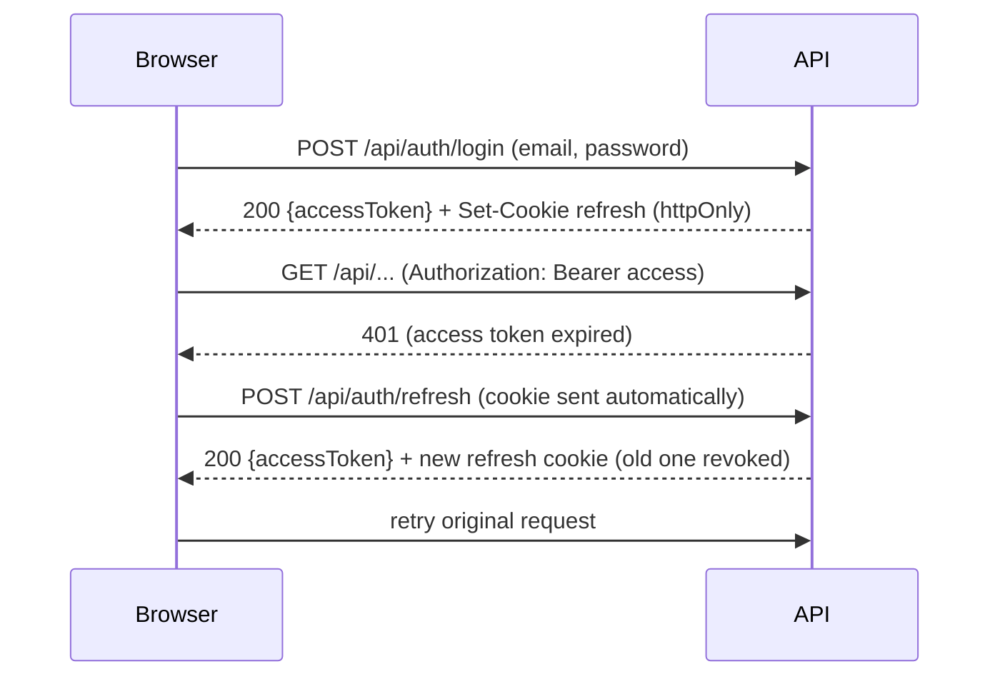

# SilicaLab: Architecture

Status: Draft

## 1. Overview

- One SPA, one API, one database. No microservices, no message queues.
- The API is stateless. All state is in PostgreSQL, so it can scale horizontally later.
- The browser sees a single origin: the API is reached through `/api`, so no CORS
  configuration is needed and the refresh cookie is first-party (ADR-005).

## 2. Architecture decisions

| ADR | Decision |
|---|---|
| 001 | ASP.NET Core with JWT |
| 002 | Access token (15 min) + rotating refresh token (7 days) |
| 003 | Guid primary keys (UUIDv7 preferred) |
| 004 | EF Core code-first with migrations |
| 005 | Refresh token in an httpOnly cookie, access token in memory |
| 006 | Request validation approach |

## 3. Runtime topology

| Mode | Database | API | Frontend |
|---|---|---|---|
| Development | Docker (`docker-compose.yml`) | native, `dotnet watch` | native, `npm run dev` with proxy to the API |
| Production / demo | Docker | Docker | Docker (nginx: static files + `/api` proxy) |

Configuration comes from environment variables (`.env` locally, never committed).
`.env.example` documents every key.


## 4. Backend

### 4.1 Layers (single project, `SilicaLab.Api`)

```
HTTP request
  → Middleware   (exception handling, rate limiting, authentication)
  → Controller   (HTTP only: bind, authorize, call service, map result to status code)
  → Service      (business rules, transactions, resource authorization)
  → AppDbContext (EF Core, PostgreSQL)
```

### 4.2 Folder layout

```
SilicaLab.Api/
├── Common/     
├── Controllers/
├── Services/          
├── Entities/
├── Dtos/              
├── Data/              
├── Validators/                
├── Program.cs
└── appsettings.json
```

### 4.3 Services

| Service | Responsibility |
|---|---|
| AuthService, TokenService | register, login, refresh with rotation and reuse detection, logout, JWT creation |
| CourseService | CRUD, publish/unpublish validation, browsing and filtering |
| LessonService | CRUD, reordering, video URL validation |
| EnrollmentService | enroll, list my courses, lesson completion, progress |
| ExamService | teacher side: manage exam settings, questions and answers, archive rules |
| AttemptService | student side: start, save answer, submit, grading, attempt limit, expiry |
| CertificateService | issue on pass, verify by code, revoke |
| CertificatePdfGenerator | QuestPDF rendering from the certificate record |
| AdminService | list and disable users, change roles, moderate courses and certificates |

### 4.4 Authorization

| Policy | Allowed roles |
|---|---|
| `CanLearn` | Student, Teacher |
| `CanTeach` | Teacher |
| `AdminOnly` | Admin |

- Controllers use `[Authorize(Policy = ...)]`.
- Resource ownership is checked in the service. When a user shouldn't know a
  resource exists, the API returns **404**, not 403.
- A deactivated user (`IsActive = false`) is rejected at login and at refresh.
  Existing access tokens expire within 15 minutes.
- Guids are not a security control. Every endpoint checks authorization.

### 4.5 Authentication flow



Token details (ADR-002, ADR-005):
- Access token: JWT, 15 minutes, `Authorization: Bearer`, kept in memory only.
- Refresh token: random value, 7 days. Only its SHA-256 hash is stored.
  Cookie flags: `HttpOnly; Secure; SameSite=Strict; Path=/api/auth`.
- Every refresh rotates the token (new token issued, old one revoked and linked
  through `ReplacedByTokenId`).
- **Reuse detection:** if a revoked token is presented outside a ~10 second grace
  window, the whole rotation chain for that user is revoked and the user must log in again.
- Logout revokes the token and clears the cookie.
- Disabling a user revokes all of their refresh tokens.
